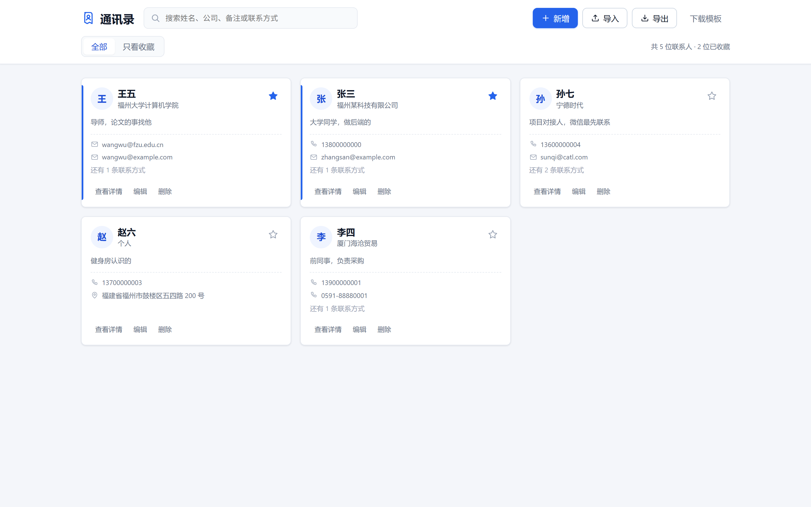
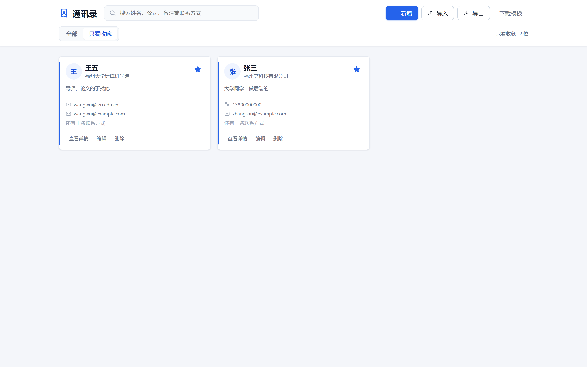
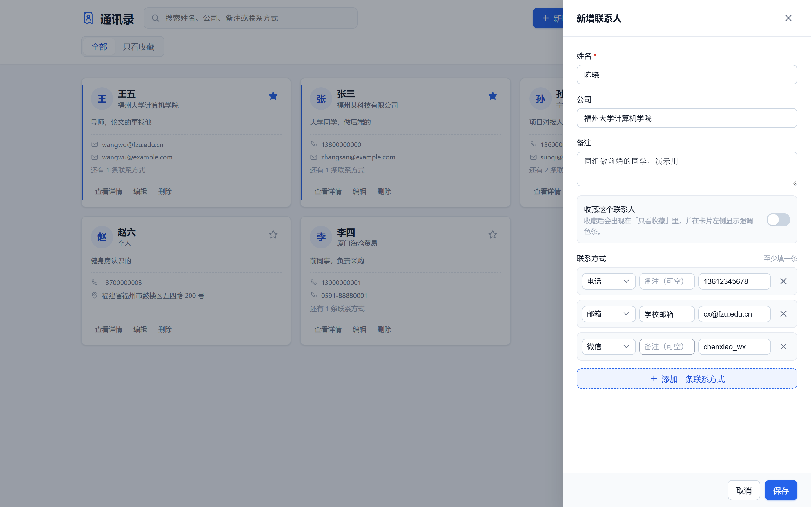
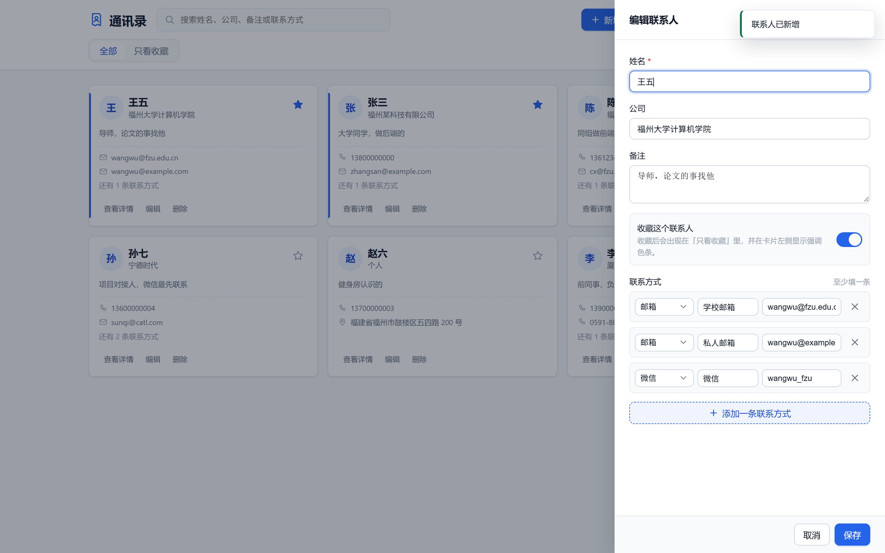
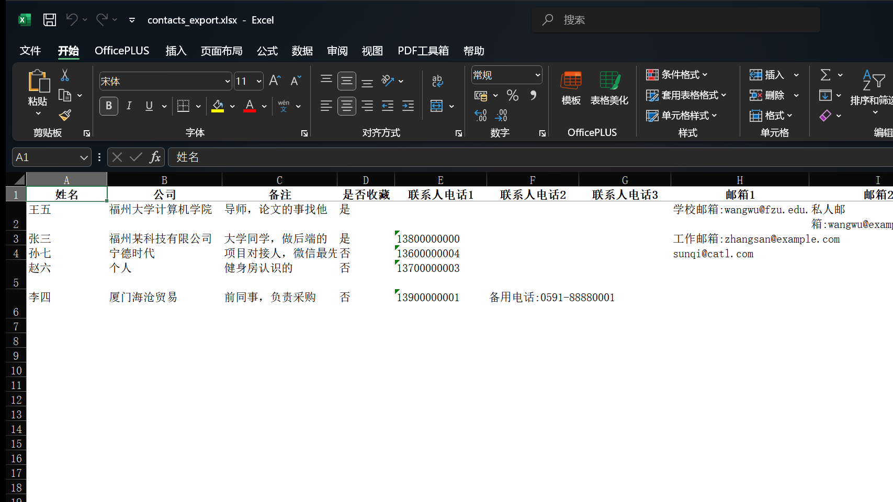
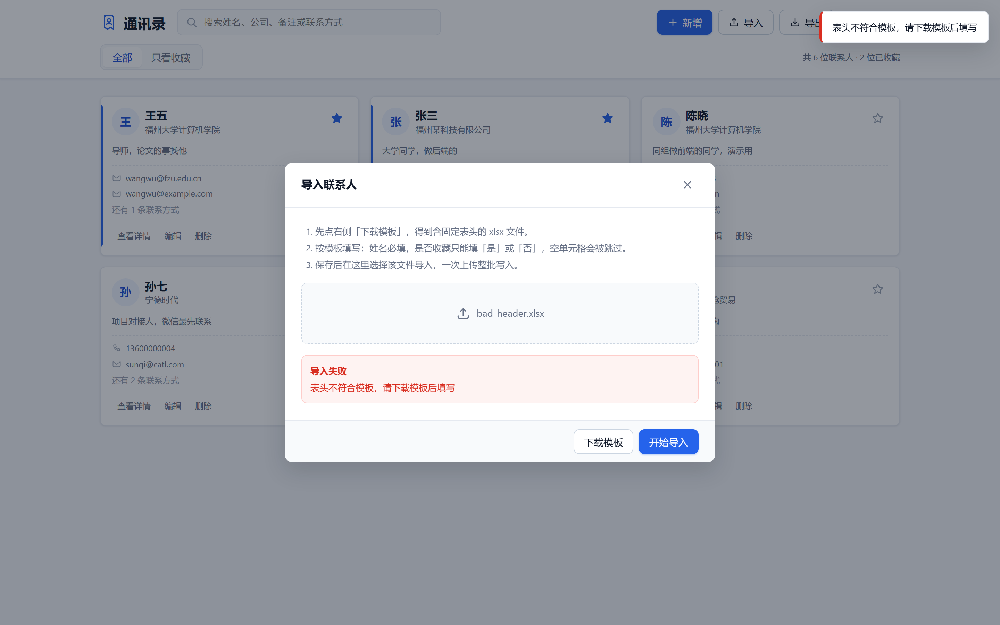
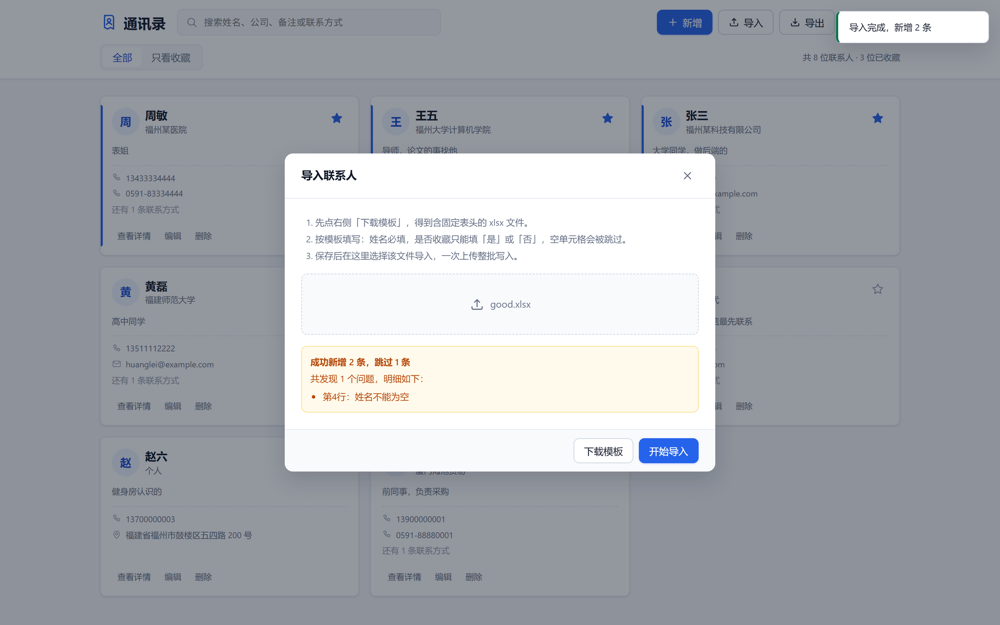
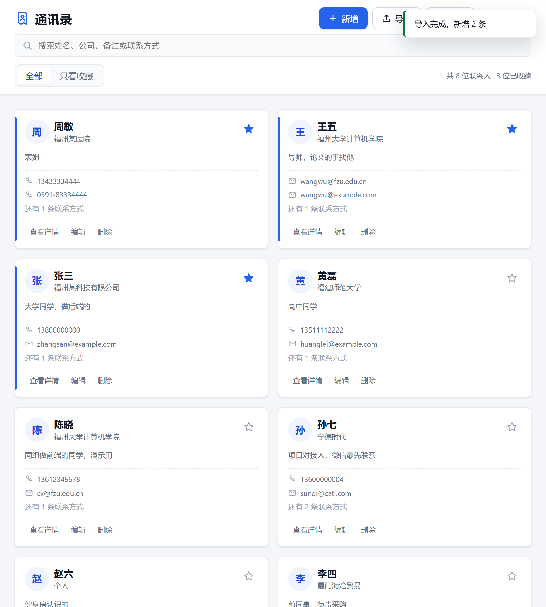

# Address Book

A web-based contact manager built for the **Extreme Programming** assignment of the Software Engineering course (FZU–MU).

The app covers four graded capabilities: **favoriting contacts**, **multiple contact methods per person (one-to-many)**, **Excel export**, and **Excel import**. On top of that it offers keyword search, a responsive card layout, and a polished form experience.

This repository is a **two-person collaboration**: Liu Ruizhi built the front end (pages, styling, interaction, demo materials), Zhang Xinyang built the back end (data layer, REST API, Excel processing). Work was split 50/50, developed on separate `feature/*` branches, and integrated through pull requests. See [Team & Division of Labor](#team--division-of-labor).

The stack is deliberately dependency-light: Flask plus the standard-library `sqlite3` on the server, plain HTML/CSS/JavaScript on the client. **No ORM, no build step, no CDN.** Clone it, install three packages, run `python app.py`, and it works — even offline.

---

## Features

| Feature | Description |
| --- | --- |
| Contact CRUD | Name, company, note, and favorite state for every contact |
| Favorites (bookmarks) | Star toggles instantly and persists; a "Favorites only" filter shows the shortlist |
| Multiple contact methods | One contact can hold many methods; types are phone / email / WeChat / address / other. Rows can be added and removed dynamically |
| Keyword search | Case-insensitive match across name, company, note, and every contact method value |
| Excel export | One contact per row, methods distributed into typed columns. Overflow beyond the available slots is joined with line breaks in the last column of that type, so **no data is lost** |
| Excel import | Strict header validation, blank-name rows skipped and reported, single-transaction write with rollback |
| Import template | One-click download of an empty template with the fixed header |

## Tech stack

| Layer | Choice |
| --- | --- |
| Language | Python 3.10+ (developed and tested on 3.12.6) |
| Web framework | Flask, plus flask-cors for cross-origin access |
| Database | SQLite through the standard-library `sqlite3` module — **no ORM** |
| Excel | openpyxl 3.1 |
| Front end | Native HTML5 / CSS3 / ES6 (fetch), no framework, no bundler, no CDN |

## Project structure

```
.
├── app.py                  # Flask entry point: blueprints, CORS, static hosting, JSON error handling
├── db.py                   # Connection, schema creation, initialization, reset
├── seed.py                 # Demo seed data (5 contacts, 2 favorites, 4 with multiple methods)
├── requirements.txt
├── api/
│   ├── __init__.py
│   ├── contacts.py         # Contact CRUD, favorites, multi-method handling
│   └── excel_io.py         # Export, template, import
├── utils/
│   ├── __init__.py
│   └── excel_schema.py     # Header constants and row <-> object conversion
├── data/                   # SQLite file lives here at runtime (git-ignored)
├── static/                 # Front end
│   ├── index.html
│   ├── css/style.css
│   └── js/app.js
├── templates/              # Reserved; the front end is fully static, so nothing is rendered here
├── tests/
│   └── smoke_test.py       # API smoke test plus an Excel round-trip check
└── docs/
    ├── demo-script.md      # Shot-by-shot recording script
    ├── deploy.md           # Cloud deployment guide
    ├── code-standards.md   # Coding conventions, Git workflow, file ownership
    └── screenshots/        # 8 real screenshots taken from the running app
```

## Quick start

### 1. Install dependencies

```bash
pip install -r requirements.txt
```

### 2. Load the demo data (recommended before recording)

```bash
python seed.py
```

This clears the database and inserts 5 contacts so the screenshots and video look consistent.

### 3. Run

```bash
python app.py
```

Open <http://127.0.0.1:5000/>.

The server binds to `0.0.0.0:5000`, so a phone on the same LAN can reach `http://<your-lan-ip>:5000/` — handy for demonstrating the responsive layout.

### 4. Run the API tests (optional)

With the server still running, in a second terminal:

```bash
python tests/smoke_test.py
```

It exercises all nine endpoints and performs an export → wipe → import → compare round-trip.

## API reference

Every response uses the same envelope:

- Success: `{"code": 0, "data": ...}`
- Failure: `{"code": <non-zero>, "message": "<human readable reason>"}`

All field names are **camelCase**. CORS is enabled for every origin so the front end can be served from a different port during development.

### Contact object

```json
{
  "id": 1,
  "name": "Zhang San",
  "company": "Fuzhou Example Tech",
  "note": "College classmate",
  "isFavorite": true,
  "methods": [
    {"type": "phone", "label": "Mobile", "value": "13800000000"},
    {"type": "email", "label": "Work email", "value": "zhangsan@example.com"}
  ]
}
```

`type` is restricted to `phone` / `email` / `wechat` / `address` / `other`; anything else is normalized to `other`.
`label` may be empty — the server falls back to the default Chinese label for that type (手机 / 邮箱 / 微信 / 地址 / 其他).

### 1. List, filter, search

```
GET /api/contacts?favorite=1&keyword=fuzhou
```

Both query parameters are optional. Ordering is favorites first, then most recently updated.

```json
{"code": 0, "data": [ {contact object}, {contact object} ]}
```

### 2. Get one contact

```
GET /api/contacts/1
```

```json
{"code": 0, "data": {"id": 1, "name": "Zhang San", "methods": [ ... ]}}
```

If the contact does not exist: `{"code": 404, "message": "联系人不存在"}`.

### 3. Create

```
POST /api/contacts
Content-Type: application/json

{
  "name": "Li Si",
  "company": "Xiamen Example Trading",
  "note": "Former colleague",
  "isFavorite": false,
  "methods": [
    {"type": "phone", "label": "Mobile", "value": "13900000001"},
    {"type": "wechat", "label": "", "value": "lisi_wx"}
  ]
}
```

Validation: `name` must be non-empty and at most 50 characters; every method `value` must be non-empty and at most 200 characters. Returns the created contact, including its `id`.

Failure example:

```json
{"code": 1, "message": "姓名不能为空"}
```

### 4. Update (full replacement)

```
PUT /api/contacts/1
```

Same body shape as create. Semantics are **full replacement**: existing methods are deleted and re-inserted from the request body, so the client must always send the complete `methods` array.

### 5. Delete

```
DELETE /api/contacts/1
```

```json
{"code": 0, "data": {"id": 1}}
```

Contact methods are removed automatically through the `ON DELETE CASCADE` foreign key.

### 6. Favorite / unfavorite

```
POST /api/contacts/1/favorite
Content-Type: application/json

{"isFavorite": true}
```

Returns the updated contact.

### 7. Export to Excel

```
GET /api/export
```

Streams a download with:

```
Content-Disposition: attachment; filename=contacts_YYYYMMDD.xlsx
```

### 8. Download the import template

```
GET /api/export/template
```

An empty workbook containing only the header row.

### 9. Import from Excel

```
POST /api/import
Content-Type: multipart/form-data
field name: file
```

```json
{"code": 0, "data": {"inserted": 5, "skipped": 0, "errors": []}}
```

With a row whose name is blank:

```json
{"code": 0, "data": {"inserted": 4, "skipped": 1, "errors": ["第3行：姓名不能为空"]}}
```

| code | Meaning |
| --- | --- |
| 1001 | Header mismatch, not an `.xlsx` file, or the file cannot be parsed |
| 1002 | Database write failed; the whole batch was rolled back |

### Error handling

Unmatched routes, disallowed methods, oversized uploads, and unhandled exceptions all return the same JSON envelope instead of an HTML error page:

```json
{"code": 404, "message": "请求的资源不存在"}
```

## Excel format

### Header (first row, fixed order, no additions or reordering)

```
姓名 | 公司 | 备注 | 是否收藏 | 联系人电话1 | 联系人电话2 | 联系人电话3 | 邮箱1 | 邮箱2 | 微信号 | 地址 | 其他
```

### Export rules

- One contact per row.
- Methods fill typed columns: `phone` → 联系人电话1/2/3, `email` → 邮箱1/2, `wechat` → 微信号, `address` → 地址, `other` → 其他.
- When a type has more values than slots, the extra values are joined with **line breaks** into the last column of that type. Nothing is discarded.
- `是否收藏` is written as `是` or `否`.
- The header row is bold and frozen; column widths are tuned for readability (name 14, company 20, address 30).

### How the `label` field survives a round-trip

`label` does not get its own column. When a label differs from the default for its type — for example "Work email" — the cell is written as `label:value`:

| 邮箱1 |
| --- |
| 工作邮箱:zhangsan@example.com |

The importer recognizes the `label:` prefix and restores the original label, so **export followed by import reproduces the data exactly, including custom labels**. The round-trip assertion in `tests/smoke_test.py` verifies this.

### Import rules

- The file must be `.xlsx`. The header is compared column by column; a missing column or a different order returns `code=1001`.
- Rows with a blank name are skipped and listed in `errors`; blank cells are ignored and produce no method.
- `是否收藏` counts as true only for `是`; anything else is false.
- The whole batch is written in one transaction; any failure rolls back and returns `code=1002`.
- The server prints `[import] inserted=n skipped=m` after each import.

## Database schema

```sql
CREATE TABLE contacts (
    id          INTEGER PRIMARY KEY AUTOINCREMENT,
    name        TEXT NOT NULL,
    company     TEXT,
    note        TEXT,
    is_favorite INTEGER NOT NULL DEFAULT 0,
    created_at  TEXT,
    updated_at  TEXT
);

CREATE TABLE contact_methods (
    id         INTEGER PRIMARY KEY AUTOINCREMENT,
    contact_id INTEGER NOT NULL,
    type       TEXT NOT NULL,
    label      TEXT,
    value      TEXT NOT NULL,
    sort_order INTEGER DEFAULT 0,
    FOREIGN KEY (contact_id) REFERENCES contacts (id) ON DELETE CASCADE
);
```

`PRAGMA foreign_keys = ON` is executed on every connection so cascade deletes actually fire. `is_favorite` is stored as 0/1 and exposed as the boolean `isFavorite`.

## Screenshots

All screenshots below were captured from the running application.

| | |
| --- | --- |
|  |  |
| Contact list with favorite accent bars | "Favorites only" filter |
|  |  |
| Adding a contact with three method types | Editing an existing contact |
|  |  |
| Exported workbook opened in Excel | Import rejected for a modified header |
|  |  |
| Import result with skipped rows and error details | Two-column responsive layout |

## Tests

`tests/smoke_test.py` uses only the standard library and covers:

- list, favorite filter, keyword search, detail
- create, full update, favorite toggle, delete, and 404 after delete
- validation rejection for an empty name
- export header and row count
- template containing only the header
- export → wipe → import → compare, including custom labels
- header mismatch returning `1001`
- blank-name rows being skipped and reported

Expected output: `通过 20 项，失败 0 项`.

## Team & Division of Labor

| Member | GitHub | Responsibility | Contribution |
| --- | --- | --- | --- |
| Liu Ruizhi | [@Llzy-666](https://github.com/Llzy-666) | Front end: page structure, CSS design system and responsive layout, all interactions (list, search, favorites, drawer form, import/export panels), demo script and screenshots | 50% |
| Zhang Xinyang | [@Tribulati0n](https://github.com/Tribulati0n) | Back end: SQLite schema and data layer, all nine REST endpoints, Excel import/export and header validation, seed data and API documentation | 50% |

### How we collaborated

Each member worked on an independent branch — `feature/backend` and `feature/frontend` — and merged into `main` through a pull request. The API contract (paths, field names, response envelope, Excel header) was fixed **before** any code was written, which is why the two halves integrated on the first attempt without adapter code.

Two rules kept the branches from diverging:

1. Neither member edited the other's files. The back end owned `app.py`, `db.py`, `api/`, `utils/`; the front end owned `static/`.
2. Every endpoint change was validated against `tests/smoke_test.py` before merging, so the contract never silently drifted.

## Documentation

- [`docs/demo-script.md`](docs/demo-script.md) — shot-by-shot recording script for the 2–3 minute demo video
- [`docs/deploy.md`](docs/deploy.md) — Ubuntu + gunicorn + Nginx deployment guide
- [`docs/code-standards.md`](docs/code-standards.md) — coding conventions, Git workflow, and file ownership

## Notes

- All SQL statements use parameterized placeholders; no string concatenation is used to build queries.
- Name and method-value lengths are validated on the server as well as in the browser.
- The code follows PEP 8: `snake_case` naming, upper-case constants, small single-purpose functions, and a Chinese docstring on every endpoint.
- `app.js` is split into three layers — `request()` unwraps the `code`/`message` envelope, `render` builds the DOM, and the event layer wires it up. `style.css` centralizes colors, radii, and spacing in CSS custom properties.
